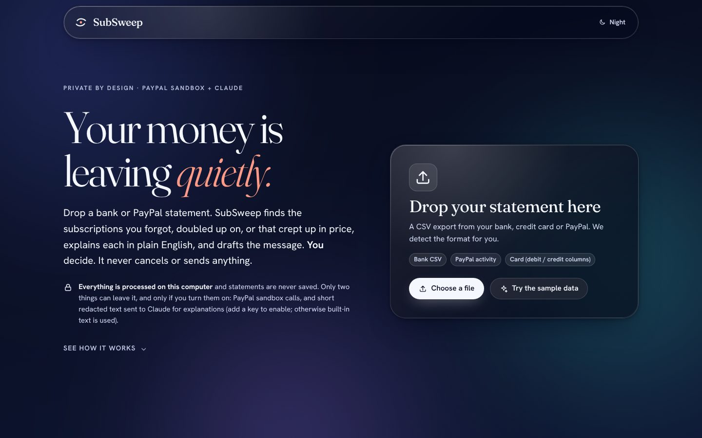
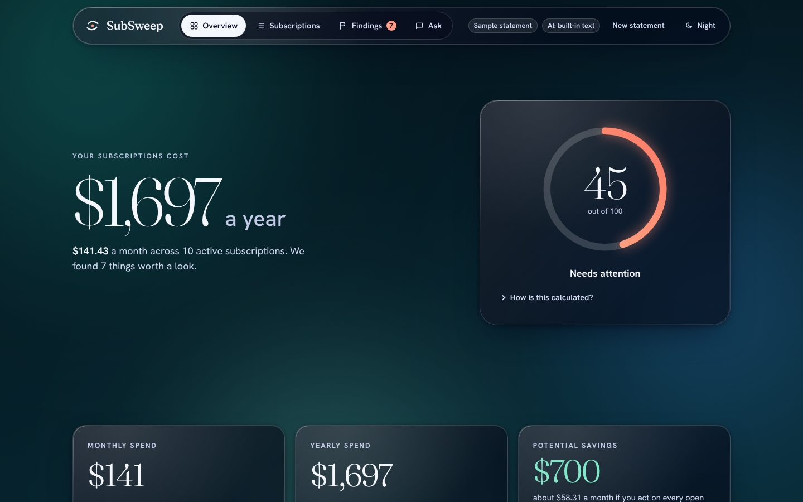
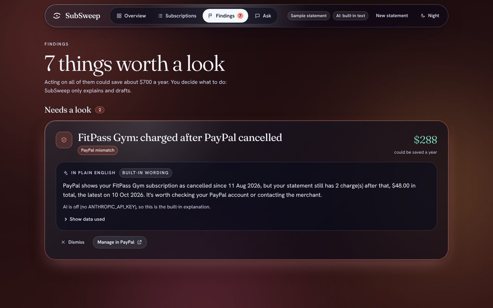
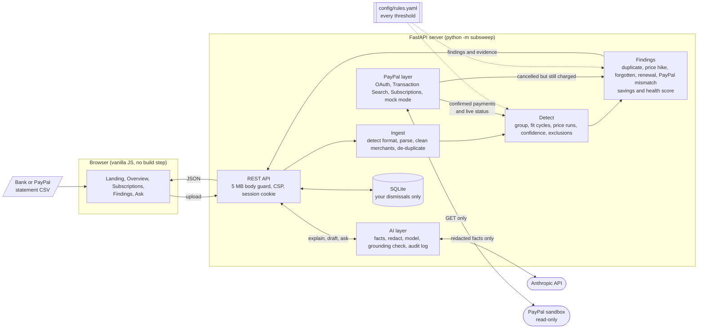

# SubSweep

**Find the subscriptions that are quietly costing you money, from a bank or PayPal statement.** SubSweep spots duplicates, price
hikes and charges you may have forgotten, explains each one in plain English, checks PayPal for the live status, and drafts the
message you could send. **You decide. It never cancels anything and never sends anything.**

Built for the PayPal AI Hackathon. MIT licensed.



## The problem

Subscriptions are easy to start and hard to keep track of. A free trial turns into a charge, a plan quietly goes up by a few
dollars, the same service ends up billed twice (once on a card, once through PayPal), and a yearly renewal lands months after you
last thought about it. Each charge is small, so none of them stands out in a long statement, but together they add up. Services
billed through PayPal's automatic payments are the hardest to see, because the billing lives in a separate place from your
bank statement.

## Who it's for

Anyone who pays for several subscriptions from a card, a bank account or PayPal and has no clear picture of what they are
paying for. The outcome SubSweep aims for is concrete: a short list of specific charges, each with a dollar amount you could
save in a year, and a draft message so acting on one takes a minute.

## What it does

- **Reads real statements.** Drop in a CSV from a bank, a card or PayPal. The format is detected automatically (or you map the
  columns once), merchant names are cleaned (`SQ *NETFLIX.COM 08/12 LOS GATOS CA` becomes `Netflix`), and duplicate rows are removed.
- **Finds recurring charges with rules you can read.** Weekly, monthly, quarterly and yearly cycles, missed or shifted payments,
  price changes, and a confidence score with a plain-English reason. Every threshold is in [`config/rules.yaml`](config/rules.yaml)
  and everything the detector drops is listed with the rule that dropped it. No black box, no ML.
- **Turns them into findings.** Duplicate subscriptions, price hikes, possibly forgotten subscriptions (labelled as a guess, with
  the evidence), upcoming annual renewals, and charges that continue after PayPal says the subscription is cancelled. Each comes
  with the yearly saving and a 0 to 100 subscription health score whose formula is shown.
- **Uses PayPal for ground truth.** Live subscription status and payments from the PayPal sandbox, merged with your statement
  without double counting. [More below](#how-paypal-is-used).
- **Uses AI only where words help.** Claude explains each finding, drafts a polite message, and answers questions about your own
  spending, but every figure it states is checked against the data it was given. [More below](#how-ai-is-used).
- **Keeps your data on your computer.** Statements live in memory, card and account numbers are redacted before any model call,
  and the only thing stored is which findings you dismissed.

| Overview | Findings |
|---|---|
|  |  |

The findings screenshot shows the built-in wording, which is what you get without an Anthropic key. With a key, Claude writes the
explanation instead (and the figures still have to match).

## Quick start

You need Python 3.11 or newer. Nothing else is required for the demo: no PayPal account, no API key, no network.

```bash
git clone https://github.com/ShlokVasandani/SubSweep.git && cd SubSweep
python -m venv .venv && source .venv/bin/activate      # Windows: .venv\Scripts\activate
pip install -r requirements.txt
python -m subsweep                                      # serves http://127.0.0.1:8000
```

Open <http://127.0.0.1:8000> and click **Try the sample data**. Optional settings (a PayPal sandbox app, an Anthropic key) go in a
`.env` file copied from [`.env.example`](.env.example); `.env` is git-ignored and nothing in the repository contains a secret.
`PORT` and `HOST` change where the server listens.

### Run the demo

1. Click **Try the sample data**. (To upload the same file yourself, `sample_data/demo_statement.csv`, start the server with
   `PAYPAL_MODE=mock python -m subsweep`; without it an uploaded file is analysed without PayPal data, so you get 6 findings
   and no PayPal panel instead of 7. Any CSV of your own works too.)
2. **Overview** shows the sample person's subscriptions: $141.43 a month, $1,697.13 a year across 10 active subscriptions, a health
   score of 45 ("Needs attention") and about $700 a year at risk across 7 findings.
3. **Findings** has the planted cases: Streamly billed twice (monthly and yearly), Netflix up from $15.49 to $17.99, Hulu
   probably forgotten, a domain renewal coming due, and FitPass Gym still charging after PayPal shows it cancelled. Open one,
   press **Show data used**, then **Draft a message** (copy only).
4. **Ask** takes questions such as "What do I spend on streaming?". Investment questions and anything unrelated to your
   statement are refused before any model call.

**Why the demo statement covers 24 months, not 12.** An annual renewal can only be detected from two yearly charges about a year
apart. A 12-month statement can hold at most one, so it could never show a renewal coming due. The sample therefore spans 24
months (588 transactions from a fixed seed, so it is reproducible; `python scripts/make_demo_data.py` regenerates it). It plants a
duplicate, a price hike, a forgotten subscription and an annual renewal, and includes groceries, fuel, coffee, rideshare and
marketplace shopping that must **not** be flagged. Dates inside the findings are relative to the last charge on the statement, so
the demo behaves the same on any day.

**The PayPal panel in the demo is demo data, and says so.** Approving a sandbox subscription is a manual step only a person can
do in a browser, so without credentials (or with `PAYPAL_MODE=mock`) SubSweep uses four bundled fictional subscriptions shaped
like PayPal's real responses. The panel is labelled "Demo data" and the notice reads "Showing bundled demo data (PayPal mock
mode). Nothing here comes from a live PayPal account." Live use is described in [Live sandbox setup](#live-sandbox-setup-optional-about-10-minutes).

### Developer commands

```bash
python -m subsweep.ingest sample_data/card_split.csv     # parse and clean a statement
python -m subsweep.detect my_statement.csv --excluded    # recurring charges, plus what was excluded and why
python -m subsweep.findings my_statement.csv             # findings, savings and health score
python -m subsweep.ai my_statement.csv --explain --ask "What do I spend on streaming?"   # works without a key
python -m subsweep.paypal status                         # PayPal view (honours PAYPAL_MODE)
python -m pytest                                         # 962 tests; browser and live PayPal checks skip themselves when unavailable
```

## Architecture



A request flows left to right: the browser uploads a file, the server parses and cleans it, detects recurring charges, merges in
PayPal data, and generates findings. Only after that does the AI layer see anything, and only a small, redacted fact sheet
about one finding or one question. The browser gets JSON and draws it; text from your statement is inserted with `textContent`
only, never as HTML.

| What leaves your computer | When | What is sent |
|---|---|---|
| Nothing | Default (no keys set) | Everything runs locally; AI features use built-in templates |
| PayPal sandbox requests | Only if you add sandbox credentials | OAuth, and read-only `GET` calls |
| Anthropic API requests | Only if you set `ANTHROPIC_API_KEY` | Redacted fact sheets (merchant, amounts, dates, cycle): never IDs, raw bank descriptions, card or account numbers, emails or phone numbers. "Show data used" reveals exactly what was sent |

## How PayPal is used

Three PayPal developer-platform APIs, all read-only and sandbox-only: **OAuth 2.0** (client credentials), **Transaction Search**
(`GET /v1/reporting/transactions`) and **Subscriptions** (`GET /v1/billing/subscriptions/{id}`). They do three jobs:

1. **Payments in.** PayPal payments are imported and merged with your statement. A bank row that mentions PayPal and matches a
   PayPal payment is kept once and marked "confirmed by PayPal", so nothing is counted twice.
2. **Live status.** Detected PayPal-billed subscriptions are matched to live PayPal subscriptions and show their status, next
   billing date and last payment.
3. **The mismatch finding.** If PayPal says a subscription is cancelled, suspended or expired but your statement keeps charging
   it, you get a high-severity `PAYPAL_MISMATCH` finding with the amount charged since.

SubSweep contains no code that cancels or suspends anything: you get a link to PayPal's automatic-payments page to act yourself,
and any non-`GET` call raises an error unless it was explicitly confirmed. Details, endpoints, scopes, retry behaviour and the
mock mode are in [PayPal integration](#paypal-integration-sandbox).

## How AI is used

Claude (via the Anthropic API) does three things: **explains** a finding in two or three calm sentences, **drafts** a polite
cancellation, price-query or refund message (never sent), and **answers questions** about your own spending by choosing one of a
fixed set of pandas analyses and wording its small result table. The design rule is that Python computes every number and the
model only words it, and that is enforced rather than requested: facts first, minimal redacted data, a grounding check that
discards any reply containing a figure or date not in the data, guardrails that refuse investment advice and prompt injection
before any model call, and an audit log. With no key, every feature falls back to a built-in template and labels itself as such.
Details are in [AI layer](#ai-layer-anthropic).

## How detection works

Recurring-charge detection is plain, explainable Python (no ML). Every threshold and keyword list lives in
[`config/rules.yaml`](config/rules.yaml); edit it and re-run. Anything the detector drops is returned in an
`excluded` table with the rule that dropped it, so no decision is a black box.

Input is the clean transactions table from the importer. Only debits (negative amounts) are considered;
refunds and credits are ignored.

| # | Rule | What it does | Config |
|---|------|--------------|--------|
| 1 | **Merchant grouping** | Names are lower-cased, geography/legal noise (`india`, `inc`, `.com`...) is dropped, aliases are applied (`spotifyab` -> `spotify`), then names join a group when rapidfuzz `token_set_ratio` >= the threshold. `Netflix.com`, `Netflix India` and `Netflx` become one group. Note: a name that is a token subset of another scores 100 (`Amazon Prime` vs `Amazon`), so groups are split into plans in step 3. | `grouping` |
| 2 | **Cycle detection** | Gaps between distinct charge dates are matched to weekly (6-8 days), monthly (28-33), quarterly (85-95) or yearly (355-375). A gap of k cycles counts as k-1 *missed* cycles (up to 2, monthly and longer only; extra tolerance of 3 days per missed cycle). A gap just outside a window (up to 3 days) counts as *shifted* and earns partial credit. The cycle with the best regularity wins and at least 60% of gaps must fit. Each cycle has a minimum charge count (weekly 4, monthly 3, quarterly 3, yearly 2). | `cycles` |
| 3 | **Plans and streams** | A merchant is split into separate subscriptions by payment channel (PayPal vs direct), currency, and amount tier (a monthly 10.99 and a yearly 109.99 plan), but only when at least two tiers each form their own cycle *and overlap in time*. A one-time big price jump is therefore one subscription, not two. A second identical charge on the same date each month is a second stream (duplicate billing); a series that fits no cycle may be split into two interleaved accounts. | `cycles.amount_split_ratio`, `try_split_interleaved` |
| 4 | **Amount stability and price changes** | A charge is *stable* if it is strictly less than 5% from the median of its price run. A price change is recorded only when the new level is >= 5% away and holds for at least 2 charges; a single odd charge is not a change, and a lone charge at a new price is reported as `pending_price_change`. Each change includes old price, new price, percent, date and annual impact. A price hike does not reduce stability. | `amounts` |
| 5 | **Confidence (0-1)** | `0.40 x timing regularity + 0.25 x amount stability + 0.35 x history`, where history = charges seen / charges for full credit (weekly 8, monthly 6, quarterly 4, yearly 3). With only 2 charges the score is capped at 0.65, with 3 at 0.85. Below 0.5 it is not reported. Every row carries a plain-English `confidence_reason`. | `confidence` |
| 6 | **False-positive exclusions** | (a) Category keywords (groceries, fuel, dining and delivery, rideshare, marketplaces) match whole words only, so `Shellfish Club` is not fuel; `never_exclude` phrases such as `Amazon Prime` and `Uber One` are protected. (b) Weekly series need stable amounts, otherwise they are habit spending. (c) For merchants that are not subscription-like, amounts that keep changing mean usage or shopping, not a fixed plan. (d) A burst of 3+ purchases inside 7 days with varying amounts is one-off repeat buying; it is removed first so it cannot hide a real monthly charge. | `exclusions`, `categories` |

Output (`detect_recurring(transactions)`): a `subscriptions` table with merchant, cycle, average and current
amount, first and last charge date, next expected date, active flag, confidence and reason, price changes,
payment channel, category hint and the transaction IDs behind each row; plus an `excluded` table with the
rule and reason for everything that was dropped.

## Findings and the health score

`generate_findings(subscriptions, transactions)` turns detected subscriptions into findings. Each has a
severity, a plain-English reason containing the exact amounts and dates, and an `evidence` dict with the raw
figures (this is what the AI layer later receives; it never invents numbers). All thresholds are under
`findings:` in `config/rules.yaml`. Only **active** subscriptions (a charge within 1.5 cycles of the statement
end) produce findings.

| Finding | Fires when | Severity | Savings counted |
|---------|-----------|----------|-----------------|
| `DUPLICATE` | Two or more active streams for the same service and currency: monthly plus annual plans, PayPal plus direct billing, two accounts, or the same charge twice each month | high | Every stream except the one with the highest yearly cost (we assume you keep one) |
| `PRICE_HIKE` | A price increase of 5% or more that held for 2+ charges (latest increase shown, with old price, new price and annual impact) | high at +25% or more, else medium | The annual impact of the increase |
| `POSSIBLY_FORGOTTEN` | A visible points score reaches 4: discretionary category (+2), billed for 6+ months (+2), identical amount every time (+1), 3+ services in the same discretionary category (+1) | medium at 5+, else low | The full yearly cost. **This is a guess**; the finding says so, lists every heuristic, and "still using" dismisses it |
| `ZOMBIE` | You supply a usage signal: charges continue 45+ days after a last-used date, or after a trial end date | high | The full yearly cost |
| `ANNUAL_RENEWAL_SOON` | A yearly charge is due within 30 days of today | high within 7 days, else medium | None (informational) |

**Savings** are summed per currency over open findings and count each subscription once: a subscription flagged
for cancellation counts its full yearly cost, one flagged only for a price hike counts the hike's annual impact,
and the stream a duplicate finding tells you to keep is not also counted as forgotten. Dismissed findings stay
listed (as dismissed) but leave the totals and the health score.

**Subscription health score** (0-100, higher is better): `100 - A - B - C`

- **A** = 50 x (potential yearly savings / yearly subscription spend): how much of your spend is at risk.
- **B** = open findings, 10 points per high, 5 per medium, 2 per low, capped at 30.
- **C** = 2 points for each active subscription beyond 8, capped at 10 (sprawl).

80 and above reads "Healthy", 55-79 "Worth a look", below 55 "Needs attention". The formula, with your numbers
filled in, is returned with every score. Mixed-currency statements are scored on the main currency.

## PayPal integration (sandbox)

SubSweep uses three PayPal developer-platform APIs, all against the **sandbox** (`api-m.sandbox.paypal.com`).
Credentials come only from environment variables (`.env`, never committed). Endpoints and scopes below were
checked against PayPal's published OpenAPI schemas.

| Need | API | Endpoint | Scope |
|------|-----|----------|-------|
| Authentication | OAuth 2.0 client credentials | `POST /v1/oauth2/token` (Basic auth, `grant_type=client_credentials`) | n/a |
| Live subscription status | Subscriptions | `GET /v1/billing/subscriptions/{id}`, `GET /v1/billing/plans/{id}` | `https://uri.paypal.com/services/subscriptions` |
| Statement import and matching | Transaction Search | `GET /v1/reporting/transactions` (`fields=all`, max 31-day windows, up to 500 per page) | `https://uri.paypal.com/services/reporting/search/read` |

**How it behaves**

- The token is cached and refreshed 60 seconds before it expires. A 401 mid-session triggers one fresh token.
- 429, 5xx and network errors are retried with exponential backoff (0.5s, 1s, 2s, 4s, capped at 8s; `Retry-After` is honoured).
- Errors are friendly and secret-free. A 403 names the missing scope when the app's own token shows it lacks it.
- Date ranges longer than 31 days are split into windows automatically; pages are followed to the end.
- Transaction rows are filtered to payments (`T00xx` event codes) that are successful or pending. Every row keeps its
  source: `paypal_api` for PayPal data, `upload:...` for your file. A bank row that mentions PayPal and matches a PayPal
  payment (same amount and currency, dates within 3 days, or the same transaction ID) is kept once and marked
  *confirmed by PayPal*, so nothing is counted twice.
- Detected PayPal-billed subscriptions are matched to live PayPal subscriptions by subscription ID (PayPal marks these on
  transactions as reference type `SUB`) or, failing that, by plan name and price. You then see status, next billing
  date and last payment.
- **Mismatch finding:** if PayPal says a subscription is `CANCELLED`, `SUSPENDED` or `EXPIRED` but your statement
  keeps charging it, you get a high-severity `PAYPAL_MISMATCH` finding. A plan price that differs from the statement
  price gives a low-severity note.
- **SubSweep never cancels anything.** There is no cancel or suspend code. You get a link to PayPal's automatic
  payments page to manage it yourself. Any non-GET call raises `ConfirmationRequired` unless explicitly confirmed;
  the seed script asks you to type `yes`.

**Important: whose point of view?** PayPal's Transaction Search and Subscriptions APIs are merchant-side: they show the
business account that owns the app. In the sandbox demo, the app's business account *receives* the buyer's subscription
payments, so SubSweep flips the sign to show them as what the subscriber pays. A real consumer product would need the
subscriber's own PayPal data, which these APIs do not expose; that is why the main path is uploading a bank or PayPal
activity CSV, with the sandbox used to demonstrate live status and verification.

### Mock mode: the demo works without any PayPal setup

Live PayPal is **optional**. Approving sandbox subscriptions is a manual step only a person can do in a browser, so
SubSweep ships bundled demo data in [`data/paypal_mock.json`](data/paypal_mock.json): four fictional subscriptions
(Streamly Plus, Streamly Plus (Annual), CloudBox Storage and FitPass Gym) with a few charges each, shaped like the real
PayPal responses.

- Set `PAYPAL_MODE=mock` and nothing else: no credentials, no network, no approval step.
- In the default `PAYPAL_MODE=live`, if any of your seeded sandbox subscriptions is still `APPROVAL_PENDING` (not yet
  approved by the buyer), SubSweep switches the **whole** PayPal view to the demo data and tells you why, rather than
  mixing live statuses with demo charges. Once everything is approved, live data is used. A failed lookup is reported,
  not hidden by the fallback.
- Demo data is always labelled: transactions have source `paypal_mock` (live PayPal rows are `paypal_api`), the
  subscriptions carry `data_source="mock"`, and the view includes the notice "Showing bundled demo data". It cannot be
  mistaken for a live PayPal account.
- The demo story is built in: Streamly Plus is billed monthly **and** yearly (a `DUPLICATE`), and FitPass Gym is
  `CANCELLED` in PayPal on 11 Aug 2026 yet still charged on 10 Sep and 10 Oct (a `PAYPAL_MISMATCH`). The other three
  subscriptions are `ACTIVE`.
- `python -m subsweep.paypal status` and `transactions` honour the mode, and `PAYPAL_MOCK_FILE` points to your own file.
  The seed script and the approval flow are unchanged.

### Live sandbox setup (optional, about 10 minutes)

Skip this section entirely if you are happy with mock mode.

1. Log in to the [PayPal Developer Dashboard](https://developer.paypal.com/dashboard/), open **Apps & Credentials**, use
   the Default Application (or **Create App**) in the sandbox, and copy the client ID and secret.
2. Under **Testing Tools > Sandbox Accounts**, note your sandbox **personal** (buyer) account; **View/Edit Account**
   shows its email and password.
3. `cp .env.example .env` and fill in `PAYPAL_CLIENT_ID`, `PAYPAL_CLIENT_SECRET` (and optionally `PAYPAL_BUYER_EMAIL`).
4. Preview, then seed the demo plans and subscriptions:
   ```bash
   python scripts/seed_paypal_sandbox.py --dry-run
   python scripts/seed_paypal_sandbox.py
   ```
5. Open each printed approval link while signed in to [sandbox.paypal.com](https://sandbox.paypal.com/signin) as the
   **buyer** and approve it. This is manual and optional: PayPal only allows approval in a browser, and until you do,
   the app uses the demo data. Then check:
   ```bash
   python scripts/seed_paypal_sandbox.py --status
   python -m subsweep.paypal transactions --days 30
   python -m pytest tests/integration -v      # live read-only checks; skipped without credentials
   ```
6. To demo a mismatch, cancel *FitPass Gym* as the buyer in the sandbox, then analyse a statement that still charges it.

Things I could not confirm from PayPal's documentation, so check them when you first run live:
whether your sandbox app needs the **Transaction Search** feature switched on (if it does not have the scope you will
get a 403 that names `https://uri.paypal.com/services/reporting/search/read`), and that the sandbox "manage
subscriptions" page is `https://www.sandbox.paypal.com/myaccount/autopay/` (the live page is
`https://www.paypal.com/myaccount/autopay/`; set `PAYPAL_MANAGE_URL` to override). Sandbox accounts only generate the
first payment when you approve a subscription, so longer payment history comes from the demo statement, not PayPal.

## AI layer (Anthropic)

Three features use the Anthropic API (`claude-opus-5-5` by default; set `SUBSWEEP_MODEL=claude-sonnet-5-5` or
`claude-haiku-5-5` to trade capability for cost). The key comes only from `ANTHROPIC_API_KEY`.

| Feature | What it does | Where the facts come from |
|---------|--------------|---------------------------|
| **Finding explainer** | 2 to 3 calm, plain-English sentences per finding, with the exact amounts and dates | The findings engine (Python), as a small JSON fact sheet |
| **Message drafter** | A short, polite cancellation / price-query / refund message for `DUPLICATE`, `PRICE_HIKE` and `POSSIBLY_FORGOTTEN`, with `[ACCOUNT NAME]`, `[ORDER / TRANSACTION DETAILS]` and `[YOUR NAME]` placeholders. **It is never sent**: SubSweep has no code to send anything, and `sent` is always `False` | The same fact sheet plus the purpose of the message |
| **Spending Q&A** | Answers questions such as "What do I spend on streaming?" or "Which subscription went up the most this year?" | A whitelisted **pandas** analysis chosen for the question. Only its small result table goes to the model |

**How "the AI never invents amounts or dates" is enforced** (not just requested in the prompt):

1. **Facts first.** Every number comes from our own computation. The model only words it.
2. **Minimal data.** Only whitelisted fields are sent: type, severity, merchant name, amounts, pre-formatted dates, cycle and
   payment channel. No subscription or transaction IDs, no raw bank descriptions.
3. **Redaction.** Card numbers (spaced, dashed or masked), account numbers, IBANs, phone numbers, email addresses (including
   UPI handles) and API keys are removed from everything before any model call, and again before anything is logged.
4. **Grounding check.** Every amount, percentage and date in the model's reply must appear in the data it was given
   (whole-number rounding allowed, counts 1 to 3 always allowed). If anything is invented, the reply is discarded and a built-in
   template built from the same facts is shown instead. Limit: this checks figures, not prose or month names without a day.
5. **Guardrails.** Investment questions (stocks, funds, crypto, retirement accounts and similar), prompt-injection attempts and
   questions unrelated to your finances are refused **before** any model call, so they cost nothing and send nothing. The same
   advice filter runs on the model's output. If your question matches no analysis, the answer says so instead of guessing; an
   empty result says "I can't find anything in your data".
6. **Audit log.** Every interaction, including refusals and template fallbacks, is appended to `logs/ai_audit.jsonl`
   (git-ignored; override with `SUBSWEEP_AI_LOG`): the redacted request, the reply, model, token usage, latency, the grounding
   verdict and the final status.
7. **"Show data used".** Every answer carries `data_used`, exactly what was sent to the model after redaction, plus the result
   table for Q&A, so the interface can reveal it on demand.

**It works without a key.** With no `ANTHROPIC_API_KEY` (or `SUBSWEEP_AI=off`), if the API is unreachable, or if the model declines
or fails the grounding check, every feature falls back to a deterministic template and says so (`generated_by: "template"`).
When the model is used, the client sets `output_config.effort` to `low`, never sends `temperature` (not accepted by this model
family), and requests Anthropic's server-side refusal `fallbacks: "default"` option; if the API rejects that option the client
retries once without it.

Question routing is rule-based first. The model is only asked to pick an analysis when the rules cannot, and only for questions
that look financial; its answer must be a JSON intent from a fixed whitelist with validated parameters.

## The web app

`python -m subsweep` starts one FastAPI server that serves both the API and the frontend (plain HTML, CSS and vanilla JS
modules, no build step). Set `PORT`/`HOST` to change `127.0.0.1:8000`. Everything it needs, including Chart.js and the two
fonts, is vendored under `web/vendor/` (licences in `web/vendor/THIRD_PARTY.md`), so it runs fully offline apart from the
optional PayPal and Anthropic calls.

| Screen | What it does |
|--------|--------------|
| **Landing** | A scroll-driven story, then the upload. Drag and drop (or choose) a CSV, or click **Try the sample data**. The format is detected automatically; if it can't be, a dialog lets you pick the date, description and amount columns (and flip the sign for exports that show purchases as positive numbers). A privacy note states exactly what can leave your computer |
| **Overview** | Health score ring (with the formula), yearly and monthly spend, potential savings, the top findings, a yearly-cost chart, and the PayPal status panel (clearly marked "Demo data" in mock mode) |
| **Subscriptions** | Sortable, filterable table (search, cycle, status, PayPal only). Each row expands to a charge-history chart, the reason for the confidence score, what PayPal says, and a "Manage in PayPal" link. On phones the table becomes cards |
| **Findings** | Cards grouped by severity. Each shows the plain-English explanation (with **Show data used**), the "why we think so" points for guesses, a **Draft a message** panel (copy only, never sent), and **Dismiss**, **Still using it** and **Undo**. Decisions are remembered in a small local SQLite file |
| **Ask** | Chat over your own numbers, with suggested questions, a refusal for investment advice and off-topic requests, "nothing to report" for empty results, and **Show data used** on every answer |

Every screen has loading skeletons, empty states and friendly error messages (a stopped server, a wrong file type, a file
that is too large, columns that can't be read). Nothing in the interface can cancel a subscription or send a message.

**Design.** A calm, trustworthy finance look with a cinematic layer: real glass (`backdrop-filter` blur with a
pointer-following sheen), a drifting aurora background, Fraunces (a warm serif) for headlines and numbers, and Hanken
Grotesk for the interface. The background **mood changes with scroll** (midnight, deep sea, dusk, ember, dawn), the landing
page unravels a messy statement into monthly rails as you scroll, and finding cards arrive from depth. Coral is the one
alert colour; everything else is neutral. There is a night theme and a day theme.

**Accessibility.** Skip link, landmarks, full keyboard use with a visible focus ring, `aria-sort`, `aria-expanded` and live
regions, alt text and a data table for every chart, and `prefers-reduced-motion` support (no pinning, scrubbing, parallax or
count-ups; everything is drawn in its finished state). Text contrast is checked by tests against the real CSS tokens and
every mood palette at its worst case: body text clears WCAG AAA (7:1) on glass and AA (4.5:1) on the bare background.

**Security and privacy.** Statements are processed in memory and never written to disk (only your dismiss decisions are
stored). Uploads are limited to 5 MB, must be `.csv`, `.tsv` or `.txt`, and are rejected if they look binary. A strict
Content-Security-Policy (`script-src 'self'`, no inline script, no external hosts) and the usual hardening headers are sent on
every response; the session cookie is `HttpOnly` and `SameSite=Strict`; AI use is capped per statement. Oversized request bodies are
cut off while they stream in (a 413, never written to disk), card and account numbers, phone numbers, email addresses and API keys are
redacted from everything sent to the model and from the audit log, and a test suite attacks the running API to keep it that way
(`tests/test_security.py`). Text from your statement
is inserted into the page with `textContent` only, which a test enforces by scanning the code and by loading a statement with
a hostile merchant name and filename in a real browser.

**Browser tests.** `python -m pytest tests/ui` drives Chromium through Playwright against a live server: keyboard use, theme
persistence and repaint, the scroll-driven theme change, reduced motion, the full sample flow, error states, the column
mapper, three viewport widths with no horizontal scroll, accessible names, and hostile text. They need Node and Playwright
(`npm i -g playwright`) and are skipped automatically otherwise.

Known limits: biweekly plans are not recognised, a single yearly charge cannot be detected, and the merchant
cleaner only strips a curated list of cities, so unusual place names can survive into the merchant name.

## Status and what has been verified

Be clear about what has and hasn't been run, because it affects how far to trust each part.

| Area | State |
|---|---|
| Ingestion, detection, findings, health score | Fully tested, including false-positive cases (groceries, fuel and coffee must not be flagged) and mutation checks that revert a rule to confirm a test fails |
| Web app and API | Tested end to end, including 21 real-browser checks (Chromium via Playwright) and a security suite that attacks the running API |
| PayPal integration | Written against PayPal's published OpenAPI schemas and tested against simulated PayPal responses. **Not yet run against the live sandbox from the build environment** (PayPal's hosts were not reachable there and no credentials were available). `python -m pytest tests/integration -v` runs read-only live checks once credentials are set, and skips cleanly otherwise |
| AI layer | Tested against a scripted fake model (request shape, error mapping, grounding, guardrails, redaction, audit log). **Not yet run against the live Anthropic API.** Without a key the built-in templates are used, and the interface shows "AI: built-in text" |

## Tests

```bash
python -m pytest              # 962 tests: 958 pass, 4 live-PayPal checks skip without credentials
python -m pytest tests/ui     # real-browser checks (needs Node and Playwright; skipped automatically otherwise)
```

The suite is hermetic: outside `tests/integration`, `PAYPAL_MODE=mock` is forced and `.env` is ignored, so no test can reach live
PayPal or the Anthropic API even when real keys are present.

## Project layout

```
subsweep/
  ingest/      statement formats, dates, amounts, merchant cleaning, de-duplication
  detect/      grouping, cycle fitting, price runs, confidence, false-positive exclusions
  findings/    finding rules, savings, health score
  paypal/      OAuth client, Transaction Search, Subscriptions, merge and matching, mock mode, seed
  ai/          fact sheets, redaction, guardrails, grounding check, audit log, explainer, drafter, Q&A
  api/         FastAPI app (uploads, sessions, security headers) and JSON serialisation
  store.py     SQLite store for your dismiss decisions (the only thing persisted)
web/           the frontend: HTML, CSS and vanilla JS modules, no build step (Chart.js and fonts vendored)
config/        rules.yaml: every detection and finding threshold
sample_data/   demo and format-test statements
scripts/       demo data generator and PayPal sandbox seed script
tests/         unit, API, security, frontend and browser tests
docs/          screenshots, Devpost text, demo video script, manual submission checklist
```

## When it was built

SubSweep was built for the PayPal AI Hackathon after its 1 October 2026 start. The first commit is dated **4 November 2026**
and every commit since is later; the work ran from **4 to 5 November 2026** and the submission deadline is 12 November 2026.

| Date | Work |
|---|---|
| 4 Nov 2026 | Phases 1 to 6: statement ingestion, detection rules, findings and health score, PayPal integration and mock mode, AI layer, web app and demo data |
| 5 Nov 2026 | Phase 7 (testing and security hardening) and Phase 8 (documentation and submission assets) |

You can check the dates yourself: `git log --reverse --format='%ad %s' --date=short`. [`PROGRESS.md`](PROGRESS.md) records what was
done, what is next and any blockers.

Third-party code and fonts (Chart.js under MIT; Fraunces and Hanken Grotesk under the SIL Open Font License) are vendored under
`web/vendor/` with their licences in `web/vendor/THIRD_PARTY.md`.

## License

MIT, see [LICENSE](LICENSE).
